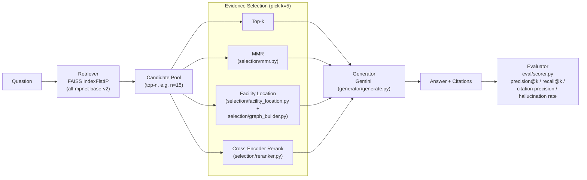

<p align="center">
  
</p>

<p align="center">
  
  
  
  
  
</p>

# Graph-Based Evidence Selection for Improving Retrieval-Augmented Generation in Large Language Models

> This project investigates whether retrieval can be improved by optimizing the diversity and complementary information content of retrieved evidence rather than maximizing similarity scores alone.

## Table of Contents

- [Overview](#overview)
- [Key Features](#key-features)
- [Architecture](#architecture)
- [Project Structure](#project-structure)
- [Getting Started](#getting-started)
  - [Prerequisites](#prerequisites)
  - [Installation](#installation)
  - [Environment Setup](#environment-setup)
- [Usage](#usage)
  - [1. Build the retrieval index](#1-build-the-retrieval-index)
  - [2. Run the baseline](#2-run-the-baseline)
  - [3. Compare selection methods](#3-compare-selection-methods)
  - [4. Inspect subgraph structure](#4-inspect-subgraph-structure)
- [Datasets](#datasets)
- [Methodology](#methodology)
  - [Evidence selection strategies](#evidence-selection-strategies)
  - [Evaluation metrics](#evaluation-metrics)
- [Results](#results)
- [Reproducing the Results](#reproducing-the-results)
- [Limitations & Future Work](#limitations--future-work)
- [Tech Stack](#tech-stack)
- [Contributors](#contributors)
- [License](#license)

## Overview

**Large language models** increasingly rely on **retrieval-augmented generation (RAG)** to supplement their internal knowledge with external documents, reducing hallucinations and allowing responses to incorporate current information. Despite these advantages, retrieval systems generally assume that the highest-ranked documents are the most useful inputs for generation. In practice, retrieved passages frequently contain redundant evidence, conflicting claims, or information that is only loosely related to the user's question. As more documents are added to the context window, model performance often plateaus or even declines because attention becomes divided across increasingly noisy inputs. Current retrieval pipelines therefore optimize for document relevance rather than for the quality of the complete evidence set presented to the language model.

This project investigates whether retrieval can be improved by optimizing the diversity and complementary information content of retrieved evidence rather than maximizing similarity scores alone. Instead of selecting the top k passages directly from a dense retriever, the system constructs a graph in which nodes represent candidate documents and weighted edges encode semantic overlap between them. A graph optimization procedure then identifies subsets of documents that collectively maximize topic coverage while minimizing redundancy. These curated evidence sets are passed to a downstream language model for question answering, with the central hypothesis that more diverse supporting information will improve factual accuracy, calibration, and reasoning performance without requiring additional retrieved context.

The group will evaluate the framework across established open-domain question answering benchmarks using publicly available Wikipedia-based corpora and compare graph-based evidence selection against conventional dense retrieval, maximal marginal relevance, and reranking approaches under identical retrieval budgets. Evaluation will measure answer correctness, citation precision, hallucination frequency, and robustness under adversarial retrieval scenarios containing partially conflicting evidence. Beyond overall performance, the study will examine how graph topology changes across different question types and whether certain structural properties of the selected evidence subgraphs correlate with improved reasoning.

## Key Features

- **Dense retrieval over FAISS** — `all-mpnet-base-v2` sentence embeddings indexed with an `IndexFlatIP`, so cosine similarity search is exact rather than approximate.
- **Four interchangeable evidence-selection strategies** — plain top-k, Maximal Marginal Relevance (MMR), (relevance-weighted) facility-location graph coverage, and cross-encoder reranking, all operating over the same candidate pool for a fair, apples-to-apples comparison.
- **Citation-grounded generation** — the generator (Gemini) is prompted to cite the exact passage IDs it used, and the scorer checks those citations against what was actually provided.
- **Built-in hallucination judging** — an LLM judge flags answers that contain claims unsupported by the provided passages.
- **Structural graph analysis** — inspects the similarity subgraph of each selected evidence set (density, clustering coefficient, average pairwise similarity) and correlates it with retrieval hits/misses.
- **Two ready-to-use corpora** — a 300-question HotpotQA dev slice and a from-scratch code-QA benchmark built by parsing the `requests` library's source tree with `ast`.

## Architecture



Candidates are fetched once per question; every selection strategy then picks its final `k` passages from that *same* pool, which is what makes the comparison in [Results](#results) controlled.

## Project Structure

```
graph-rag-evidence-selection/
├── data/                       # Datasets + dataset builders
│   ├── hotpotqa_dev_300.jsonl      # 300 HotpotQA dev questions
│   ├── all_passages.jsonl          # deduplicated passages for the HotpotQA set
│   ├── code_passages.jsonl         # 320 function/class chunks from `requests`
│   ├── code_questions.jsonl        # 18 hand-written code-QA questions, 1 gold passage each
│   ├── build_dataset.py            # regenerates the HotpotQA files
│   └── build_code_dataset.py       # regenerates the code-QA corpus via `ast`
├── retriever/                  # Dense retrieval
│   ├── build_index.py              # embeds passages, writes a FAISS index + id map
│   └── retrieve.py                 # top-k / candidate-pool retrieval
├── selection/                  # Evidence selection strategies
│   ├── graph_builder.py            # passage×passage similarity graph + query similarities
│   ├── mmr.py                      # Maximal Marginal Relevance
│   ├── facility_location.py        # greedy (weighted) facility location
│   ├── reranker.py                 # cross-encoder reranking
│   └── structural_analysis.py      # density / clustering coefficient of a selected subgraph
├── generator/                  # Answer generation
│   └── generate.py                 # Gemini prompting with forced citations
├── eval/                       # Scoring
│   └── scorer.py                   # precision@k, recall@k, citation precision, hallucination
├── scripts/                    # End-to-end experiment runners
│   ├── run_baseline.py             # Week 1: plain top-k baseline
│   ├── run_comparison.py           # Week 2: top-k vs. MMR vs. facility location
│   ├── run_week3_comparison.py     # Week 3: + relevance-weighted facility location + reranking
│   └── run_structural_analysis.py  # subgraph structure vs. hit/miss
├── results/                    # JSON outputs written by the scripts above
└── assets/                     # README images (this file)
```

## Getting Started

### Prerequisites

- Python **3.14** (the dataset builders and scripts are run with `python3.14` / `python3` in this repo)
- A [Google AI Studio](https://aistudio.google.com/) API key for the Gemini generator
- ~2 GB free disk for cached `sentence-transformers` / cross-encoder model weights

### Installation

```bash
git clone https://github.com/lukesiravakian/graph-rag-evidence-selection.git
cd graph-rag-evidence-selection
python3 -m venv .venv
source .venv/bin/activate
pip install -r requirements.txt
```

### Environment Setup

Generation calls the Gemini API, so a key must be available in a `.env` file at the project root:

```bash
cp .env.example .env
```

Then edit `.env` and set:

```
GOOGLE_API_KEY=your-api-key-here
```

`generator/generate.py` loads this with `python-dotenv` before creating the `genai` client.

## Usage

All commands below are run from the **project root** — the retrieval and data scripts resolve paths such as `data/` and `retriever/` relative to the current working directory.

### 1. Build the retrieval index

Required once before any retrieval, selection, or generation script will work:

```bash
python retriever/build_index.py
```

This embeds every passage in `data/code_passages.jsonl` with `all-mpnet-base-v2`, L2-normalizes the vectors, and writes `retriever/passage_index.faiss` + `retriever/id_map.json`.

### 2. Run the baseline

Plain top-k retrieval → Gemini, scored against the gold passage for each question:

```bash
python scripts/run_baseline.py
```

Writes [`results/code_baseline_week1.json`](results/code_baseline_week1.json).

### 3. Compare selection methods

Runs every evidence-selection strategy on the same question set and the same candidate pool, including citation precision and LLM-judged hallucination rate:

```bash
python scripts/run_week3_comparison.py
```

Writes [`results/week3_full_comparison.json`](results/week3_full_comparison.json). An earlier, metrics-only version (`top_k` vs. `mmr` vs. unweighted `facility_location`) is available via:

```bash
python scripts/run_comparison.py
```

### 4. Inspect subgraph structure

Computes density, clustering coefficient, and average pairwise similarity of the passages selected by relevance-weighted facility location, and checks whether those properties correlate with retrieval hits:

```bash
python scripts/run_structural_analysis.py
```

Writes [`results/structural_analysis.json`](results/structural_analysis.json).

## Datasets

| Dataset | Files | Size | Notes |
| --- | --- | --- | --- |
| **HotpotQA (dev slice)** | [`data/hotpotqa_dev_300.jsonl`](data/hotpotqa_dev_300.jsonl), [`data/all_passages.jsonl`](data/all_passages.jsonl) | 300 questions | Multi-hop open-domain QA with supporting-fact annotations. Regenerate with `python3.14 data/build_dataset.py`. |
| **Code-QA (`requests` corpus)** | [`data/code_passages.jsonl`](data/code_passages.jsonl), [`data/code_questions.jsonl`](data/code_questions.jsonl) | 320 passages / 18 questions | Function/class-level chunks parsed from the `requests` source tree with Python's `ast` module; each question has exactly one gold `passage_id`. Regenerate with `data/build_code_dataset.py`. |

See [`data/README.md`](data/README.md) for the full field-level schema of each file.

## Methodology

### Evidence selection strategies

All four strategies below select `k = 5` passages from the **same** candidate pool of `n = 15` passages retrieved for a question, so differences in downstream scores are attributable to the selection rule rather than to retrieval quality.

| Strategy | Module | Idea |
| --- | --- | --- |
| **Top-k** | `retriever/retrieve.py` | The `k` nearest neighbors of the query by cosine similarity. The conventional RAG baseline. |
| **MMR** | `selection/mmr.py` | Iteratively picks the candidate that maximizes `λ · relevance − (1 − λ) · redundancy` against what's already selected (`λ = 0.5` by default). |
| **Facility location (weighted)** | `selection/facility_location.py`, `selection/graph_builder.py` | Greedily picks the candidate that most increases a blended objective `(1 − α) · coverage_gain + α · relevance`, where coverage gain is how much the passage×passage similarity graph's total "best representative" score improves (`α = 0.5` by default). `α = 0` recovers the original, query-agnostic coverage-only objective. |
| **Cross-encoder reranking** | `selection/reranker.py` | Scores every `(query, passage)` pair with `cross-encoder/ms-marco-MiniLM-L-6-v2` and keeps the top `k` by that score. |

### Evaluation metrics

For each question, the retrieved passage IDs are compared with the gold passage IDs supplied with that question. Let $S_q$ be the set of distinct IDs selected for question $q$, and let $G_q$ be its gold ID set. Precision@k and recall@k are:

$$
\mathrm{Precision}_q@k = \frac{|S_q \cap G_q|}{|S_q|},
\qquad
\mathrm{Recall}_q@k = \frac{|S_q \cap G_q|}{|G_q|}
$$

with both metrics defined as 0 when their denominator is 0, and reported as the arithmetic mean across questions (`eval/scorer.py`).

**Citation precision** checks whether the passage IDs an answer cites were actually among the passages provided to the generator:

$$
\mathrm{CitationPrecision}_q =
\begin{cases}
\dfrac{\sum_{c \in C_q} \mathbf{1}[c \in P_q]}{|C_q|}, & |C_q| > 0 \\[4pt]
0, & |C_q| = 0
\end{cases}
$$

**Hallucination rate** is judged by an LLM (Gemini): given the question, the answer, and the provided passages, the judge flags whether the answer makes claims unsupported by those passages. The reported rate is the fraction of answers flagged across the question set.

## Results

<p align="center">
  
</p>

### Performance Comparison Across Selection Methods

| Method | Precision@5 | Recall@5 | Citation Precision | Hallucination Rate |
| --- | --- | --- | --- | --- |
| **Top-$k$ Baseline** | 0.16 | 0.78 | 0.89 | 0.00 |
| **MMR** | 0.14 | 0.72 | 0.83 | 0.06 |
| **Reranking** | 0.16 | 0.78 | 0.67 | 0.00 |
| **Facility Location (Weighted)** | 0.14 | 0.72 | 0.78 | 0.00 |

Across the 4 methods, each evaluating 5 passages, standard Top-k and Reranking achieved the highest retrieval overlap with recall scores of 0.78, while Facility Location and MMR both reached 0.72, showing that enforcing structural diversity is a tradeoff for higher raw recall rates. In terms of retrieval precision, Top-k and Reranking achieved Precision@5 of 0.16, outperforming MMR and Facility Location, which showed 0.14 precision rates. This indicates that focusing on similarity yields somewhat more targeted results, whereas diversity selection returns a wider variety. Citation precision ranged from 0.89 (Top-K) to 0.67 (Reranking), with in-between values of 0.83 for MMR and 0.78 for Facility Location. Hallucination rate was 0 for all methods except MMR, which showed a slight bump to 0.06.

**Read with care:** `n = 18` questions, so a single question is worth ~5.6 points of recall — gaps of one question (e.g. the MMR-vs-top-k recall difference) are within noise. Both diversity-aware methods are also capped by the `n = 15` candidate pool: neither can ever retrieve a gold chunk that didn't make it into the pool. Full caveats — duplicate passage IDs, non-persisted retrieved-ID lists, non-byte-identical re-runs — are documented in [`results/README.md`](results/README.md).

## Reproducing the Results

```bash
# 1. Build the FAISS index (needed by every script below)
python retriever/build_index.py

# 2. Week 1 baseline — plain top-k
python scripts/run_baseline.py

# 3. Week 2 — top-k vs. MMR vs. (unweighted) facility location
python scripts/run_comparison.py

# 4. Week 3 — + relevance-weighted facility location + reranking, with
#    citation precision and hallucination rate
python scripts/run_week3_comparison.py

# 5. Structural analysis of the selected evidence subgraphs
python scripts/run_structural_analysis.py
```

Every `scripts/run_*.py` file calls the generator, so `GOOGLE_API_KEY` must be set in `.env` first (see [Environment Setup](#environment-setup)). Outputs land in `results/` and are not edited by hand — see [`results/README.md`](results/README.md) for exactly what each file contains.

## Limitations & Future Work

- **Small sample size.** The code-QA benchmark has 18 questions over a single codebase (`requests`); differences smaller than one question are noise, and findings may not generalize to other repositories or question types.
- **Single embedding model.** Only `all-mpnet-base-v2` has been tested as the retriever backbone; a different embedding model could change the candidate pool and the ranking within it.
- **Candidate-pool ceiling.** MMR and facility location can only ever select from the top-`n` retrieved candidates, so they cannot recover a gold passage the retriever missed entirely.
- **Query-agnostic coverage (unweighted facility location).** The original facility-location objective ignores the question after the initial retrieval step, which is the leading hypothesis for why it underperforms top-k — this is what the relevance-weighted variant (`α`) is designed to address.
- **Citation precision is post-filtered.** The generator discards citation IDs that don't match a provided passage before returning them, so citation precision mostly reflects *whether an answer cited anything acceptable at all*, not whether the model could have hallucinated an invalid ID.
- **Hallucination rate is LLM-judged, not human-verified.**
- **Planned:** evaluate on the HotpotQA open-domain slice (currently only the code-QA corpus has full comparison results), run a case-by-case error analysis of retrieval misses, and test additional embedding/generator models.

## Tech Stack

| Layer | Library |
| --- | --- |
| Embeddings & reranking | [`sentence-transformers`](https://www.sbert.net/) (`all-mpnet-base-v2`, `cross-encoder/ms-marco-MiniLM-L-6-v2`) |
| Vector search | [`faiss-cpu`](https://github.com/facebookresearch/faiss) (`IndexFlatIP`) |
| Generation | [`google-genai`](https://pypi.org/project/google-genai/) (Gemini) |
| Core ML | `torch`, `numpy`, `pandas`, `datasets` |
| Config | `python-dotenv` |

See [`requirements.txt`](requirements.txt) for pinned versions.

## Contributors

This is a collaborative research project. Contributors (by commit history):

- Derek Turso
- Sukanya Mondal
- Viet Anh Ho
- Luke Siravakian
- Sasha Zhidkova

## License

No license has been specified for this repository yet. Until one is added, all rights are reserved by the contributors — please reach out before reusing this code.
