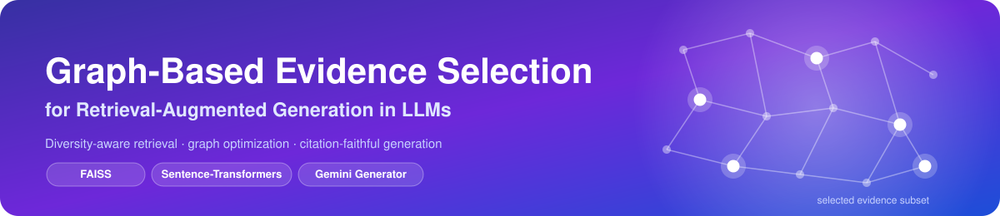
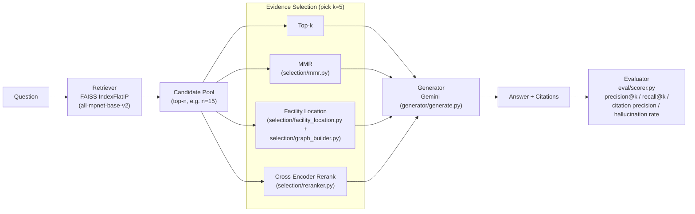
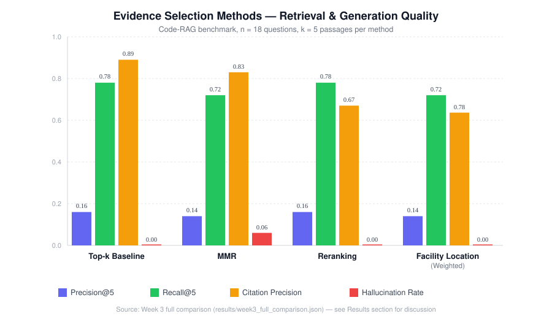

<p align="center">
  
</p>

<p align="center">
  
  
  
  
  
</p>

# Graph-Based Evidence Selection for Improving Retrieval-Augmented Generation in Large Language Models

> This project investigates whether retrieval can be improved by optimizing the diversity and complementary information content of retrieved evidence rather than maximizing similarity scores alone.

## Table of Contents

- [Overview](#overview)
- [Key Features](#key-features)
- [Architecture](#architecture)
- [Project Structure](#project-structure)
- [Getting Started](#getting-started)
  - [Prerequisites](#prerequisites)
  - [Installation](#installation)
  - [Environment Setup](#environment-setup)
- [Usage](#usage)
  - [1. Build the retrieval index](#1-build-the-retrieval-index)
  - [2. Run the baseline](#2-run-the-baseline)
  - [3. Compare selection methods](#3-compare-selection-methods)
  - [4. Inspect subgraph structure](#4-inspect-subgraph-structure)
  - [5. Instrument the selection objective](#5-instrument-the-selection-objective)
  - [6. Attribute the misses](#6-attribute-the-misses)
  - [7. Compute the significance statistics](#7-compute-the-significance-statistics)
- [Datasets](#datasets)
- [Methodology](#methodology)
  - [Evidence selection strategies](#evidence-selection-strategies)
  - [Evaluation metrics](#evaluation-metrics)
- [Results](#results)
- [Reproducing the Results](#reproducing-the-results)
- [Limitations & Future Work](#limitations--future-work)
- [Tech Stack](#tech-stack)
- [Contributors](#contributors)
- [License](#license)

## Overview

**Large language models** increasingly rely on **retrieval-augmented generation (RAG)** to supplement their internal knowledge with external documents, reducing hallucinations and allowing responses to incorporate current information. Despite these advantages, retrieval systems generally assume that the highest-ranked documents are the most useful inputs for generation. In practice, retrieved passages frequently contain redundant evidence, conflicting claims, or information that is only loosely related to the user's question. As more documents are added to the context window, model performance often plateaus or even declines because attention becomes divided across increasingly noisy inputs. Current retrieval pipelines therefore optimize for document relevance rather than for the quality of the complete evidence set presented to the language model.

This project investigates whether retrieval can be improved by optimizing the diversity and complementary information content of retrieved evidence rather than maximizing similarity scores alone. Instead of selecting the top k passages directly from a dense retriever, the system constructs a graph in which nodes represent candidate documents and weighted edges encode semantic overlap between them. A graph optimization procedure then identifies subsets of documents that collectively maximize topic coverage while minimizing redundancy. These curated evidence sets are passed to a downstream language model for question answering, with the central hypothesis that more diverse supporting information will improve factual accuracy, calibration, and reasoning performance without requiring additional retrieved context.

**What has actually been evaluated so far.** The project began on an open-domain text
corpus — a 300-question HotpotQA dev slice, which is still in `data/` — but that slice
was only ever used to validate the pipeline end to end. Every reported result comes
instead from a retrieval-augmented **code** question-answering benchmark built here: 18
hand-written questions over 320 function and class definitions parsed out of the Python
`requests` library. Code was chosen because redundancy and complementarity between
passages are easier to characterize when functions, classes, and call sites are tied
together by explicit structural relations. Graph-based evidence selection is compared
against plain dense top-k retrieval, MMR, and cross-encoder reranking under identical
retrieval budgets, scored on retrieval precision and recall, citation precision, and an
LLM-judged hallucination rate. The structural question — whether properties of the
selected evidence subgraph correlate with retrieval success — is addressed in
[Results](#results). Two things in the original plan have **not** been done: answer
correctness is never graded, and no adversarial / conflicting-evidence condition has
been run.

## Key Features

- **Dense retrieval over FAISS** — `all-mpnet-base-v2` sentence embeddings indexed with an `IndexFlatIP`, so cosine similarity search is exact rather than approximate.
- **Four interchangeable evidence-selection strategies** — plain top-k, Maximal Marginal Relevance (MMR), (relevance-weighted) facility-location graph coverage, and cross-encoder reranking, all operating over the same candidate pool for a fair, apples-to-apples comparison.
- **Citation-grounded generation** — the generator (Gemini) is prompted to cite the exact passage IDs it used, and the scorer checks those citations against what was actually provided.
- **Built-in hallucination judging** — an LLM judge flags answers that contain claims unsupported by the provided passages.
- **Structural graph analysis** — inspects the similarity subgraph of each selected evidence set (density, clustering coefficient, average pairwise similarity) and correlates it with retrieval hits/misses.
- **An instrumented objective and a reported ablation** — the greedy loop can report the value of both of its score terms at every step, which is how the coverage-vs-relevance scale gap was found, and the coverage-only (`α = 0`) variant is kept as a first-class ablation rather than deleted.
- **Reproducible statistics** — Wilson intervals, exact McNemar bounds, and the Fisher exact test are computed by a script from the saved result files, not by hand.
- **Two ready-to-use corpora** — a 300-question HotpotQA dev slice and a from-scratch code-QA benchmark built by parsing the `requests` library's source tree with `ast`.

## Architecture



Candidates are fetched once per question; every selection strategy then picks its final `k` passages from that *same* pool, which is what makes the comparison in [Results](#results) controlled.

## Project Structure

```
graph-rag-evidence-selection/
├── data/                       # Datasets + dataset builders
│   ├── hotpotqa_dev_300.jsonl      # 300 HotpotQA dev questions
│   ├── all_passages.jsonl          # deduplicated passages for the HotpotQA set
│   ├── code_passages.jsonl         # 320 function/class chunks from `requests`
│   ├── code_questions.jsonl        # 18 hand-written code-QA questions, 1 gold passage each
│   ├── build_dataset.py            # regenerates the HotpotQA files
│   └── build_code_dataset.py       # regenerates the code-QA corpus via `ast`
├── retriever/                  # Dense retrieval
│   ├── build_index.py              # embeds passages, writes a FAISS index + id map
│   └── retrieve.py                 # top-k / candidate-pool retrieval
├── selection/                  # Evidence selection strategies
│   ├── graph_builder.py            # passage×passage similarity graph + query similarities
│   ├── mmr.py                      # Maximal Marginal Relevance
│   ├── facility_location.py        # greedy (weighted) facility location + instrumented trace
│   ├── reranker.py                 # cross-encoder reranking
│   └── structural_analysis.py      # density / clustering coefficient of a selected subgraph
├── generator/                  # Answer generation
│   └── generate.py                 # Gemini prompting with forced citations
├── eval/                       # Scoring
│   └── scorer.py                   # precision@k, recall@k, citation precision, hallucination
├── scripts/                    # End-to-end experiment runners
│   ├── run_baseline.py             # Week 1: plain top-k baseline
│   ├── run_comparison.py           # Week 2: top-k vs. MMR vs. facility location
│   ├── run_week3_comparison.py     # Week 3: + relevance-weighted facility location + reranking
│   ├── run_structural_analysis.py  # subgraph structure vs. hit/miss
│   ├── run_alpha_instrumentation.py # per-step values of the two terms of Algorithm 1
│   ├── run_miss_analysis.py        # was each missed gold passage even in the pool?
│   └── run_significance_tests.py   # Wilson / McNemar / Fisher statistics
├── results/                    # JSON outputs written by the scripts above
└── assets/                     # README images (this file)
```

## Getting Started

### Prerequisites

- Python **3.12** (`torch==2.2.2`, pinned in `requirements.txt`, has no wheels for 3.13+)
- A [Google AI Studio](https://aistudio.google.com/) API key for the Gemini generator
- ~2 GB free disk for cached `sentence-transformers` / cross-encoder model weights

### Installation

```bash
git clone https://github.com/lukesiravakian/graph-rag-evidence-selection.git
cd graph-rag-evidence-selection
python3 -m venv .venv
source .venv/bin/activate
pip install -r requirements.txt
```

### Environment Setup

Generation calls the Gemini API, so a key must be available in a `.env` file at the project root:

```bash
cp .env.example .env
```

Then edit `.env` and set:

```
GOOGLE_API_KEY=your-api-key-here
```

`generator/generate.py` loads this with `python-dotenv` before creating the `genai` client.

## Usage

All commands below are run from the **project root** — the retrieval and data scripts resolve paths such as `data/` and `retriever/` relative to the current working directory.

### 1. Build the retrieval index

Required once before any retrieval, selection, or generation script will work:

```bash
python retriever/build_index.py
```

This embeds every passage in `data/code_passages.jsonl` with `all-mpnet-base-v2`, L2-normalizes the vectors, and writes `retriever/passage_index.faiss` + `retriever/id_map.json`.

### 2. Run the baseline

Plain top-k retrieval → Gemini, scored against the gold passage for each question:

```bash
python scripts/run_baseline.py
```

Writes [`results/code_baseline_week1.json`](results/code_baseline_week1.json).

### 3. Compare selection methods

Runs every evidence-selection strategy on the same question set and the same candidate pool, including citation precision and LLM-judged hallucination rate:

```bash
python scripts/run_week3_comparison.py
```

Writes [`results/week3_full_comparison.json`](results/week3_full_comparison.json). An earlier, metrics-only version (`top_k` vs. `mmr` vs. unweighted `facility_location`) is available via:

```bash
python scripts/run_comparison.py
```

### 4. Inspect subgraph structure

Computes density, clustering coefficient, and average pairwise similarity of the passages selected by relevance-weighted facility location, and checks whether those properties correlate with retrieval hits:

```bash
python scripts/run_structural_analysis.py
```

Writes [`results/structural_analysis.json`](results/structural_analysis.json).

### 5. Instrument the selection objective

Reports, for the candidate chosen at each greedy step, the coverage gain, the relevance
term, and their ratio — the measurement behind the finding that `α = 0.5` does not
split influence evenly between the two terms:

```bash
python scripts/run_alpha_instrumentation.py
```

Writes [`results/alpha_instrumentation.json`](results/alpha_instrumentation.json).
Needs the FAISS index but no API key.

### 6. Attribute the misses

For every question, records whether the gold passage reached the `n = 15` pool and
whether each method selected it — which separates retrieval failures from selection
failures and reports the recall ceiling for the pool-based methods:

```bash
python scripts/run_miss_analysis.py
```

Writes [`results/miss_analysis.json`](results/miss_analysis.json). Needs the FAISS index
but no API key.

### 7. Compute the significance statistics

Wilson intervals for recall@5, exact McNemar bounds on the recall gaps, and a two-sided
Fisher exact test on the density table, all computed from the saved result files:

```bash
python scripts/run_significance_tests.py
```

Writes [`results/significance_tests.json`](results/significance_tests.json). Needs no
model, no index, and no API key.

## Datasets

| Dataset | Files | Size | Notes |
| --- | --- | --- | --- |
| **HotpotQA (dev slice)** | [`data/hotpotqa_dev_300.jsonl`](data/hotpotqa_dev_300.jsonl), [`data/all_passages.jsonl`](data/all_passages.jsonl) | 300 questions | Multi-hop open-domain QA with supporting-fact annotations. **Used only to validate the pipeline end to end — no reported result comes from it.** Regenerate with `python data/build_dataset.py`. |
| **Code-QA (`requests` corpus)** | [`data/code_passages.jsonl`](data/code_passages.jsonl), [`data/code_questions.jsonl`](data/code_questions.jsonl) | 320 passages / 18 questions | **The benchmark behind every reported number.** Function/class-level chunks parsed from the `requests` source tree with Python's `ast` module; each question has exactly one gold `passage_id`. Only 280 of the 320 `passage_id`s are distinct — see [`data/README.md`](data/README.md). Regenerate with `python data/build_code_dataset.py` after cloning `requests` into `data/source_repo` (that tree is gitignored). |

See [`data/README.md`](data/README.md) for the full field-level schema of each file.

## Methodology

### Evidence selection strategies

All four strategies below select `k = 5` passages from the **same** candidate pool of `n = 15` passages retrieved for a question, so differences in downstream scores are attributable to the selection rule rather than to retrieval quality.

| Strategy | Module | Idea |
| --- | --- | --- |
| **Top-k** | `retriever/retrieve.py` | The `k` nearest neighbors of the query by cosine similarity. The conventional RAG baseline. |
| **MMR** | `selection/mmr.py` | Iteratively picks the candidate that maximizes `λ · relevance − (1 − λ) · redundancy` against what's already selected (`λ = 0.5` by default). |
| **Facility location (weighted)** | `selection/facility_location.py`, `selection/graph_builder.py` | Greedily picks the candidate that most increases a blended objective `(1 − α) · coverage_gain + α · relevance`, where coverage gain is how much the passage×passage similarity graph's total "best representative" score improves (`α = 0.5` by default). `α = 0` recovers the original, query-agnostic coverage-only objective. |
| **Cross-encoder reranking** | `selection/reranker.py` | Scores every `(query, passage)` pair with `cross-encoder/ms-marco-MiniLM-L-6-v2` and keeps the top `k` by that score. |

### Evaluation metrics

For each question, the retrieved passage IDs are compared with the gold passage IDs supplied with that question. Let $S_q$ be the set of distinct IDs selected for question $q$, and let $G_q$ be its gold ID set. Precision@k and recall@k are:

$$
\mathrm{Precision}_q@k = \frac{|S_q \cap G_q|}{|S_q|},
\qquad
\mathrm{Recall}_q@k = \frac{|S_q \cap G_q|}{|G_q|}
$$

with both metrics defined as 0 when their denominator is 0, and reported as the arithmetic mean across questions (`eval/scorer.py`).

**Citation precision** checks whether the passage IDs an answer cites were actually among the passages provided to the generator:

$$
\mathrm{CitationPrecision}_q =
\begin{cases}
\dfrac{\sum_{c \in C_q} \mathbf{1}[c \in P_q]}{|C_q|}, & |C_q| > 0 \\[4pt]
0, & |C_q| = 0
\end{cases}
$$

**Hallucination rate** is judged by an LLM (Gemini): given the question, the answer, and the provided passages, the judge flags whether the answer makes claims unsupported by those passages. The reported rate is the fraction of answers flagged across the question set.

## Results

<p align="center">
  
</p>

### Performance Comparison Across Selection Methods

| Method | Precision@5 | Recall@5 | Hits | Citation Precision | Hallucination Rate |
| --- | --- | --- | --- | --- | --- |
| **Top-$k$ Baseline** | 0.16 | 0.78 | 14 / 18 | 0.89 | 0.00 |
| **Reranking** | 0.16 | 0.78 | 14 / 18 | 0.67 | 0.00 |
| **MMR** | 0.14 | 0.72 | 13 / 18 | 0.83 | 0.06 |
| **Facility Location ($\alpha = 0.5$)** | 0.14 | 0.72 | 13 / 18 | 0.78 | 0.00 |
| **Facility Location ($\alpha = 0$, coverage only)** | 0.09 | 0.44 | 8 / 18 | — | — |

Across the four selection methods, each handing the generator 5 passages, standard
Top-k and Reranking achieved the highest retrieval overlap with recall@5 of 0.78 (14 of
18 questions), while Facility Location and MMR both reached 0.72 (13 of 18).
Precision@5 follows the same order, 0.16 against 0.14. Citation precision ranged from
0.89 (Top-k) down to 0.67 (Reranking), with 0.83 for MMR and 0.78 for Facility
Location — notably, Reranking matched Top-k on recall while scoring the lowest on
citations. The hallucination rate was 0.00 for every method except MMR, which flagged
one answer out of 18 (0.06).

**The headline is parity, not a win.** Weighted facility location matched MMR and did
not beat ranking by similarity alone. The informative comparison is the ablation: the
coverage-only variant (`α = 0`), which ignores the query entirely once the pool is
retrieved, scored *well below every baseline* at 0.09 / 0.44. Representativeness alone
is not a sufficient selection criterion; adding the relevance term closed most of that
gap but did not open a new one.

**Why the relevance term only acts late.** Instrumenting the greedy loop
(`scripts/run_alpha_instrumentation.py`) shows the nominal 0.5/0.5 split is not what
happens. At the first selection step the coverage term is **16.2 to 25.0× larger** than the
relevance term (Δc 9.39–11.98 against rel 0.44–0.74) — it sums a contribution over all
15 pool members while relevance is a single cosine bounded in [-1, 1]. The gap narrows
as the pool saturates. So `α = 0.5` gives coverage effective control of the first pick
or two, and relevance only matters for the picks after that.

**Selected-set density beats average similarity as a warning signal.** Stratifying the
18 questions by the density of the selected five-passage subgraph (edges at cosine ≥
0.5) separates hits from misses far more sharply than the average similarity does:

| Selected-set density | Questions | Gold retrieved | Hit rate |
| --- | --- | --- | --- |
| `< 1.0` (not fully similar) | 7 | 7 | 1.000 |
| `= 1.0` (fully similar) | 11 | 6 | 0.545 |

Average pairwise similarity, by contrast, is 0.618 for the 13 hits against 0.642 for
the 5 misses — essentially the same range. This suggests a cheap diagnostic: flag a
selection as higher risk when its own density saturates.

**Read with care:** `n = 18` questions, so a single question is worth ~5.6 points of
recall — the one-question gaps here cannot reach significance under any pattern (exact
McNemar p = 1.0). The density split is descriptive too: a two-sided Fisher exact test
gives p = 0.10, and the analysis was added after the main comparison, so it is
exploratory rather than confirmatory. The `n = 15` candidate pool is **not** the
binding constraint here, contrary to what a pool-size caveat would suggest: the gold
passage reaches the pool for all 18 questions (`scripts/run_miss_analysis.py`), so the
recall ceiling for MMR, facility location, and reranking is 1.00 and every one of their
misses is a selection error rather than a retrieval failure. Top-k's four misses, by
contrast, are ranking failures on passages that *were* in the pool — so headroom over
top-k did exist and the selection rules did not find it. Reranking's precision is 0.1556 and Top-k's is 0.1630 —
both round to 0.16 above, but the difference is an artifact of duplicate passage IDs,
not of retrieval. Full caveats — duplicate passage IDs, non-persisted retrieved-ID
lists, an unvalidated LLM judge, post-filtered citations, non-byte-identical re-runs —
are documented in [`results/README.md`](results/README.md). All the statistics quoted
here come from `scripts/run_significance_tests.py`.

## Reproducing the Results

```bash
# 1. Build the FAISS index (needed by every script below)
python retriever/build_index.py

# 2. Week 1 baseline — plain top-k
python scripts/run_baseline.py

# 3. Week 2 — top-k vs. MMR vs. (unweighted) facility location
python scripts/run_comparison.py

# 4. Week 3 — + relevance-weighted facility location + reranking, with
#    citation precision and hallucination rate
python scripts/run_week3_comparison.py

# 5. Structural analysis of the selected evidence subgraphs
python scripts/run_structural_analysis.py

# 6. The coverage-vs-relevance scale gap inside the selection objective
python scripts/run_alpha_instrumentation.py

# 7. Per-method misses: retrieval failure or selection failure?
python scripts/run_miss_analysis.py

# 8. Wilson intervals, McNemar bounds, Fisher exact test
python scripts/run_significance_tests.py
```

Steps 2–4 call the generator, so `GOOGLE_API_KEY` must be set in `.env` first (see [Environment Setup](#environment-setup)). Steps 5–7 need the FAISS index but no API key; step 8 needs neither — it reads the JSON written by the earlier steps. Outputs land in `results/` and are not edited by hand — see [`results/README.md`](results/README.md) for exactly what each file contains.

## Limitations & Future Work

- **Small sample size.** The code-QA benchmark has 18 questions over a single codebase (`requests`); differences smaller than one question are noise, and findings may not generalize to other repositories or question types.
- **Single embedding model.** Only `all-mpnet-base-v2` has been tested as the retriever backbone; a different embedding model could change the candidate pool and the ranking within it.
- **Candidate-pool ceiling — measured, and it does not bind.** MMR, facility location, and reranking can only select from the top-`n` retrieved candidates, but on this benchmark the gold passage is in the pool of 15 for **all 18 questions**, so their ceiling is recall 1.00 and the pool size explains none of their misses. Every miss is attributable to the selection rule. Run `python scripts/run_miss_analysis.py` to reproduce.
- **Query-agnostic coverage (unweighted facility location).** The original facility-location objective ignores the question after the initial retrieval step, which is the leading hypothesis for why it underperforms top-k — this is what the relevance-weighted variant (`α`) is designed to address.
- **Citation precision is post-filtered.** The generator discards citation IDs that don't match a provided passage before returning them, so citation precision mostly reflects *whether an answer cited anything acceptable at all*, not whether the model could have hallucinated an invalid ID.
- **Hallucination rate is LLM-judged, not human-verified.** The judge also runs at the API's default temperature, unlike the generator, which is pinned to 0.1.
- **`α` was never swept.** Every weighted result uses the single value `α = 0.5`, and the instrumentation shows that value does not mean what it looks like it means — the coverage term dominates the first picks regardless. A sweep is the obvious next experiment.
- **Per-question hit/miss is not persisted for the baselines**, so the paired test that the one-question gaps call for can only be bounded, not computed. Saving the selected ID lists per method would fix this at no cost.
- **Answer correctness is never scored.** All four metrics are about retrieval and grounding; none of them says whether an answer is right.
- **Planned:** sweep `α`, evaluate on the HotpotQA open-domain slice (currently only the code-QA corpus has full comparison results), repeat the comparison on more repositories, and test additional embedding/generator models.

## Tech Stack

| Layer | Library |
| --- | --- |
| Embeddings & reranking | [`sentence-transformers`](https://www.sbert.net/) (`all-mpnet-base-v2`, `cross-encoder/ms-marco-MiniLM-L-6-v2`) |
| Vector search | [`faiss-cpu`](https://github.com/facebookresearch/faiss) (`IndexFlatIP`) |
| Generation | [`google-genai`](https://pypi.org/project/google-genai/) (Gemini) |
| Core ML | `torch`, `numpy`, `pandas`, `datasets` |
| Config | `python-dotenv` |

See [`requirements.txt`](requirements.txt) for pinned versions.

## Contributors

This is a collaborative research project. Contributors (by commit history):

- Derek Turso
- Sukanya Mondal
- Viet Anh Ho
- Luke Siravakian
- Sasha Zhidkova

## License

No license has been specified for this repository yet. Until one is added, all rights are reserved by the contributors — please reach out before reusing this code.
